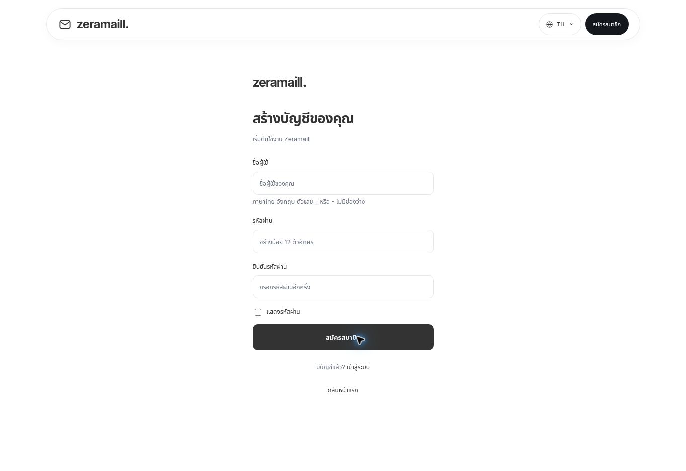

# Verification

- `npm test`: real HTTP integration test passed: signup, mismatched password rejection, duplicate/case-insensitive username rejection, login, session logout, unauthenticated rejection, member isolation, administrator authorization, order transitions, CSRF rejection, encrypted payout details, and persistence across server restart.
- `npm run build`: TypeScript check and Vite production build passed.
- Browser: landing → registration, registration/login navigation, and anonymous submit → login checked. Signup layout inspected visually. No user credentials were requested or entered during browser QA.
- No production hosting or live bank transaction was performed. Bank transfers are manual; only their reference is recorded by the administrator.

